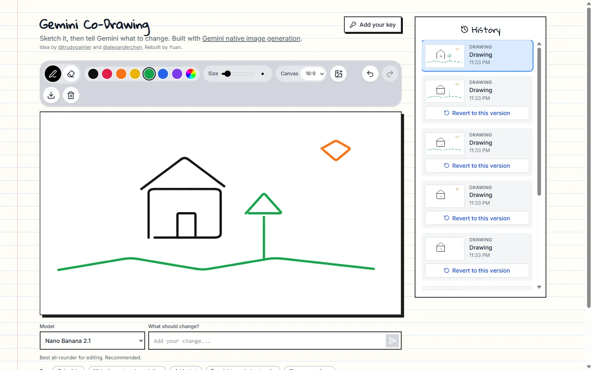
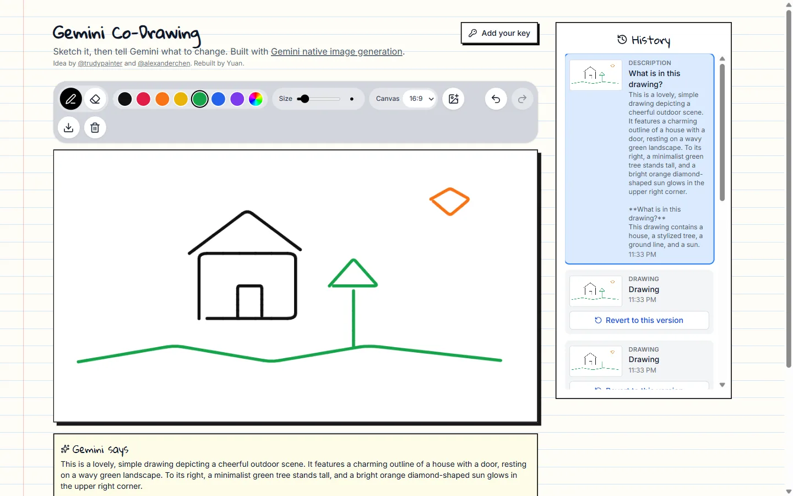
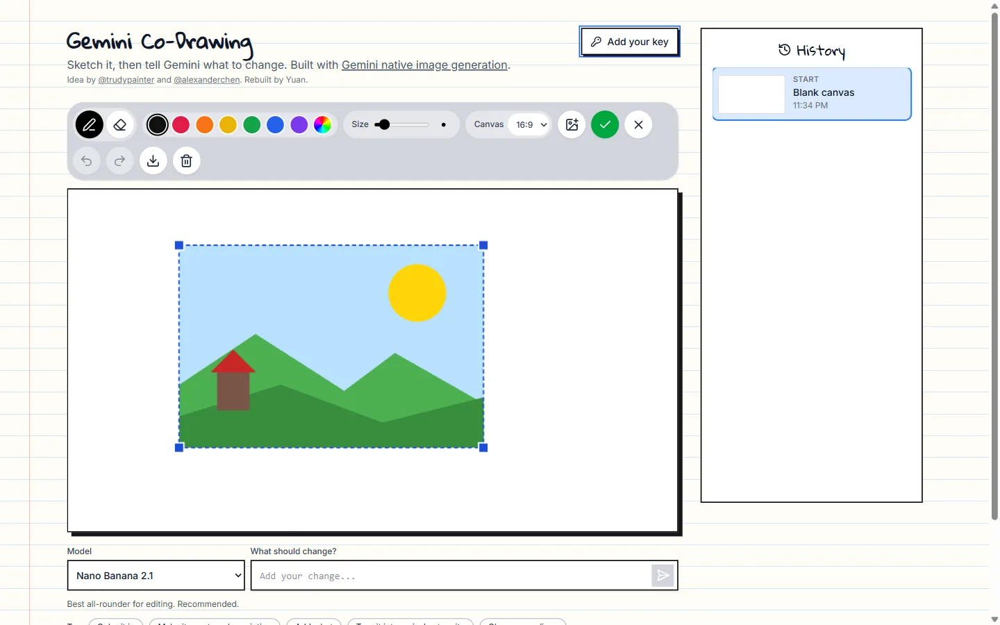
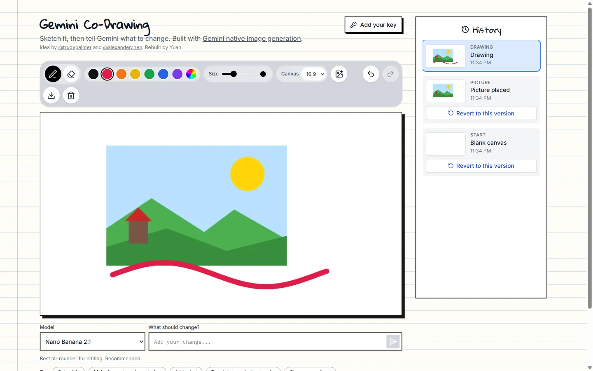
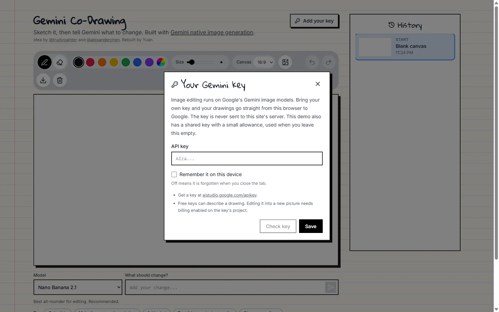
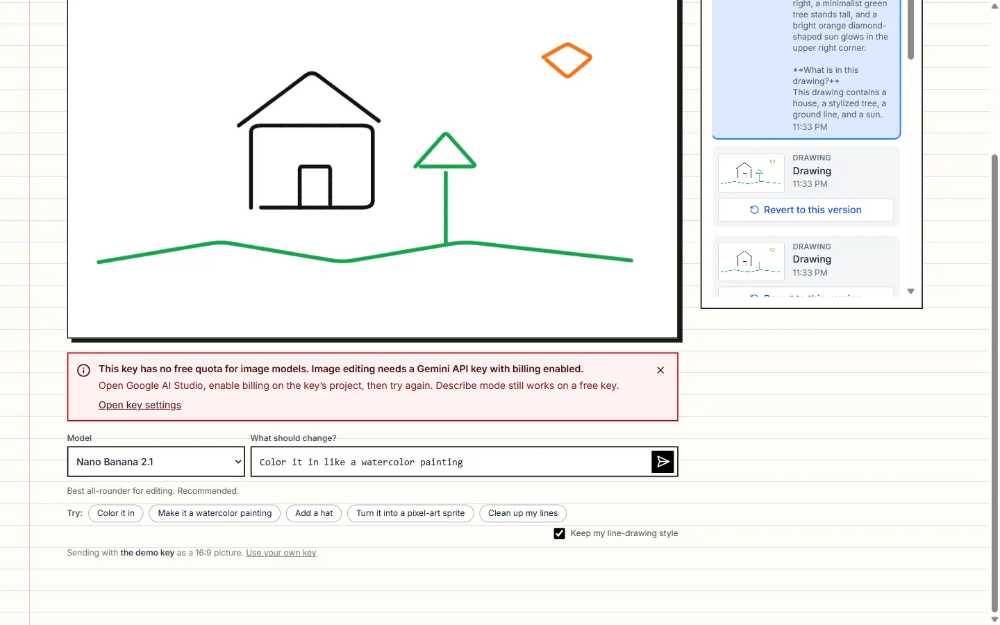
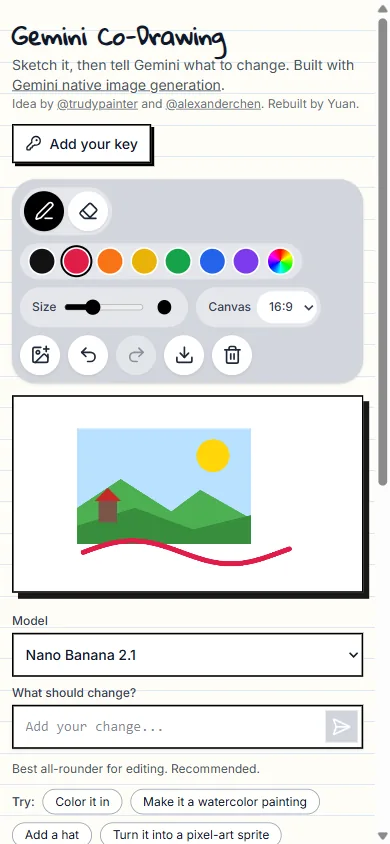

# Gemini Co-Drawing

Sketch on a canvas, tell Gemini what to change, and watch your drawing turn into the edited picture. Built on the
Gemini image models (Nano Banana), with a React canvas editor and one small Vercel function.

**Live:** https://geminicodrawingmodifiedbyyuan.vercel.app



## A look inside

| Screen | Preview |
|---|---|
| Draw, then ask: pen and eraser, colours, brush size, canvas shape, undo and redo |  |
| **Describe** mode: a real Gemini reply to "What is in this drawing?", saved in the history |  |
| Bring a picture: drag it, resize it from a corner, press Enter to place it |  |
| Every change is a version you can go back to |  |
| Your own key: it stays in this browser and goes straight to Google |  |
| A key without billing: edits explain what to do instead of failing silently |  |



The describe and billing screens are real responses from the Gemini API. Image edits need a key with billing enabled, so
no edited picture is shown here.

## What you can do

- Draw with a pen or eraser (mouse, finger or stylus), pick any colour and a brush size.
- Add a picture by upload, paste or drag-and-drop, then move and resize it before placing it on the canvas.
- Ask Gemini to edit the whole drawing in plain words ("add a red hat", "make it a watercolor").
- Ask Gemini to **describe** the drawing instead, which works on a free API key.
- Undo, redo, revert to any earlier version in the history, and download the result as a PNG.
- Choose the canvas shape (16:9, 4:3, 1:1, 3:4, 9:16). The edited picture comes back in the same shape.

## Models

Checked against the live Gemini model list in October 2026.

| In the app | Model id | Use |
|---|---|---|
| Nano Banana 2.1 (default) | `gemini-nano-banana-2.1` | Best all-rounder for editing |
| Nano Banana 2 Lite | `gemini-3.1-flash-lite-image` | Fastest, simple edits |
| Nano Banana Pro | `gemini-3-pro-image` | Most detailed results |
| Nano Banana (classic) | `gemini-2.5-flash-image` | Original model, kept as a fallback |
| Gemini Flash (describe) | `gemini-2.5-flash` | Words about the drawing |

Google retires models often, so each one has a fallback chain (see `src/lib/models.ts`). If a model answers 404 or is
too busy after one retry, the next one is tried and the history entry says which model actually ran.

**What changed from the first version:** `gemini-2.5-flash-image-preview` and `gemini-2.0-flash-preview-image-generation`
no longer exist (the API answers 404), and Imagen has been shut down, so the old model menu could not produce a picture.
The old Vercel deployment was also gone.

## Image editing needs billing

Google gives free keys **zero** quota for the image models (the API answers 429 with `limit: 0`). To edit pictures, use a
key from a Google project with billing enabled. The describe mode and everything on the canvas work on a free key. The app
tells visitors this plainly instead of showing a generic failure.

## Keys and privacy

There are two ways to run an edit:

1. **Bring your own key** (Settings). The browser calls Google directly. The key is kept in this browser only, either for
   the tab or on the device if you choose "Remember", and is never sent to this site's server.
2. **Shared server key** (optional). If the deployment has `GEMINI_API_KEY`, visitors without a key use it through
   `/api/generate`, limited to 8 requests per address every 10 minutes. The key never reaches the browser.

The first version compiled the key into the JavaScript bundle (`process.env.API_KEY` through Vite `define`), which
published it to every visitor. That is gone: there is no `VITE_` variable and nothing secret in the bundle.

## How it works

```
browser canvas ──► src/lib/gemini.ts ──► Google                    (your own key, direct)
        └──────► /api/generate ──► src/lib/gemini.ts ──► Google    (shared key, rate limited)
```

- `src/lib/studio.ts` is the drawing engine: an off-screen canvas, a movable picture layer, and a history of PNG blobs.
- `src/lib/gemini.ts` builds the `generateContent` request, reads the reply, maps errors to plain codes
  (`billing_required`, `invalid_key`, `rate_limited`, `overloaded`, `blocked`, `no_image` and more) and walks the model chain.
  The browser and the server route share it, so there is one place that knows the request shape.
- `api/generate.ts` validates input (model allowlist, size, prompt length), applies the rate limit and calls the library.

Request sent for an edit:

```json
{
  "contents": [{ "role": "user", "parts": [
    { "inlineData": { "mimeType": "image/png", "data": "<canvas>" } },
    { "text": "Edit the attached drawing: add a red hat. Keep the same minimal line-drawing style ..." }
  ] }],
  "generationConfig": { "responseModalities": ["TEXT", "IMAGE"], "imageConfig": { "aspectRatio": "16:9" } }
}
```

## Run locally

```bash
npm install
cp .env.example .env.local     # optional: add GEMINI_API_KEY for the shared-key mode
npm run dev                    # http://localhost:5173, /api/generate is served by the dev server too
```

Try it without a billing key: `node test/mock-google.mjs`, then
`GEMINI_API_ORIGIN=http://127.0.0.1:8799 GEMINI_API_KEY=mock npm run dev`. The mock answers every edit with a gradient
picture, and putting `quota`, `busy`, `gone`, `words` or `blocked` in the prompt triggers that failure.

```bash
npm test                # request shape, error mapping, model fallback, and the API route against a mock Google
npm run build           # type-checks, then builds to dist/
npx tsx test/live.mts   # optional: one real call per mode with the key in GEMINI_API_KEY
```

## Deploy

Import the repository in Vercel (framework: Vite). `vercel.json` sets the build and the 60 second function limit. Add
`GEMINI_API_KEY` as an environment variable only if you want the shared-key mode, and remember that a key with billing is
spendable by anyone who finds the site, which is what the per-address limit is for.

## Credits

The idea and the first version come from Google's AI Studio sample by
[@trudypainter](https://x.com/trudypainter) and [@alexanderchen](https://x.com/alexanderchen) (Apache-2.0). This version
was rebuilt by [Yuan Andrei Mariano](https://github.com/yuan05-afk): a real build setup, a server-side key, current models
with fallbacks, a pen and eraser, pointer-event drawing that works on touch, canvas shapes, and tests.
